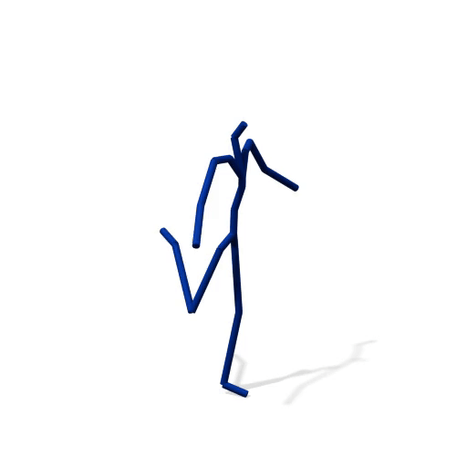
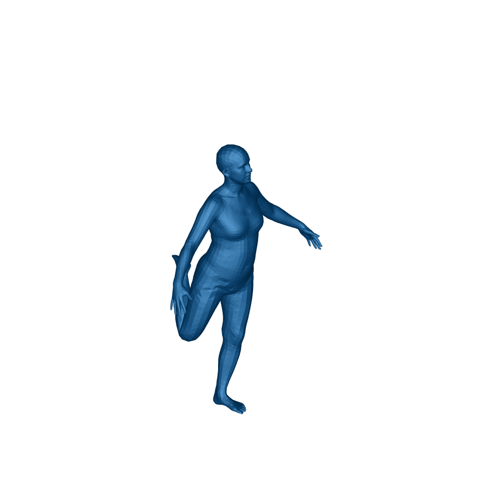
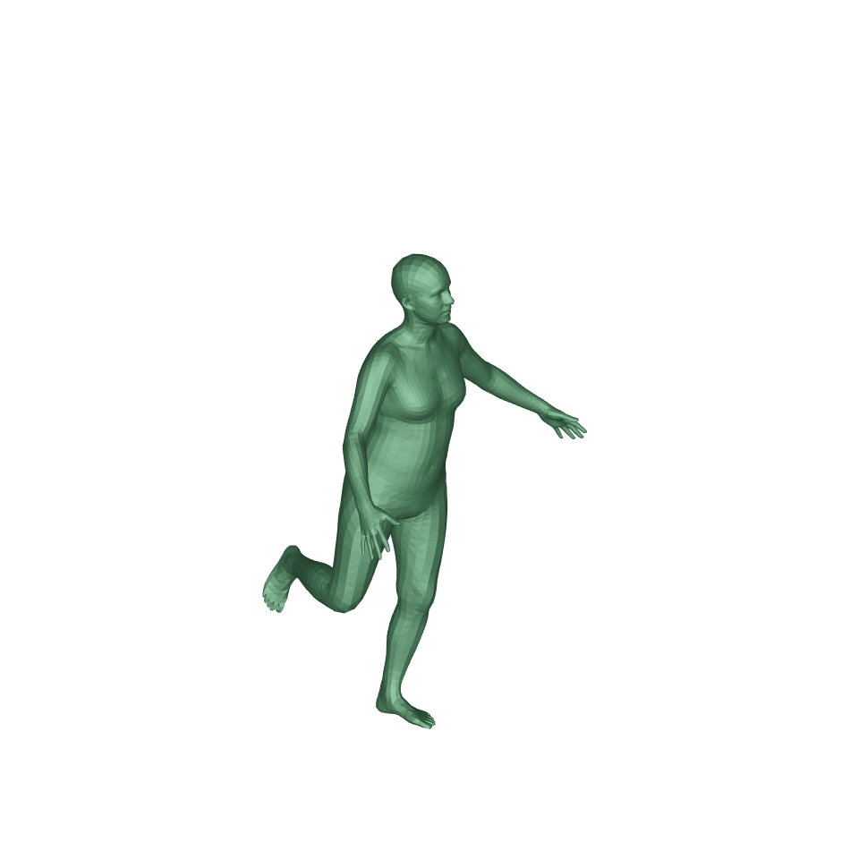

# AMASS Skeleton to SMPL Mesh for Human Motion Prediction

Convert AMASS-format 3D joint sequences to SMPL meshes. This repository is tailored for Human Motion Prediction (HMP) workflows: it first fits an observation sequence and then efficiently initializes and fits one or more future predictions.

| Input: AMASS Skeleton | Output: SMPL Mesh |
| :---: | :---: |
|  |  |

If this repository helps your research, please star it and cite our work.

**[SkeletonDiffusion Codebase](https://github.com/Ceveloper/SkeletonDiffusion/tree/main)** · **[Project Page](https://ceveloper.github.io/publications/skeletondiffusion/)** · **[arXiv](https://arxiv.org/abs/2501.06035)**

## Overview

- **Input:** AMASS skeleton sequences (`F × 22 × 3`, xyz in `m|cm|mm`). One file must be the observation (filename contains `obs`); the rest are predictions.
- **Output:** Per-frame SMPL meshes as `.obj` files saved in a corresponding `<stem>_obj` folder, plus cached SMPL parameters for the observation (`obs_as_optimized_smpl.npz`). A script to visualize mesh sequences as transparent GIFs is also provided.
- **Method:** Fits a SMPL model to the observation sequence and reuses its shape, camera, and last-frame pose to initialize the prediction sequences. With `--sequential_init`, future frames are fit sequentially (`t` initialized from `t-1`, batched across predictions) for temporal coherence; otherwise, all frames are fit in parallel (batched over time for speed). The root translation is set to zero, as it is typically ignored in HMP.
- **Note:** The generated meshes are intended for visualization, not for metric evaluation, as the fitting process can slightly alter the skeleton geometry.
- **Beyond HMP:** You can adapt the code to convert any AMASS motion sequence to SMPL by treating each sequence as an "observation".

## Setup

### 1. Environment
```bash
conda env create -f environment.yml
conda activate skeleton2mesh
```

#### Chumpy Fix
Some `chumpy` wheels are broken with modern Python versions. A fork with a fix needs to be installed manually:
```bash
pip install --no-build-isolation git+https://github.com/mikigom/chumpy.git
```

### 2. Body Models
Download the required body model assets.

1.  **SMPL Models**: Follow the instructions at the [MAS repository](https://github.com/roykapon/MAS?tab=readme-ov-file#output) to download the SMPL assets.
2.  **GMM Prior**: Download the `gmm_08.pkl` from the [MAS repository](https://github.com/roykapon/MAS/blob/main/visualize/joints2smpl/smpl_models/gmm_08.pkl).

Place the downloaded files in the `./body_models/` directory as follows:

```
body_models/
├── smpl/
│   ├── SMPL_NEUTRAL.pkl
│   └── J_regressor_extra.npy
└── joints2smpl/
    └── gmm_08.pkl
```

## Data Format

- Input files should be `.npy` arrays with the shape `F × J × 3`, containing AMASS joints (`J=22`).
- The default unit is meters, but this can be overridden with the `--unit {m,cm,mm}` flag.
- In a directory of sequences, one file must contain `obs` in its name (the observation), while all others are treated as corresponding predictions.

An example dataset is available at `./example_data/SkeletonDiffusion_example/`.

## Run Conversion

Convert skeletons to meshes using the following command. The script will automatically use a CUDA device if available.
```bash
python skeleton2mesh.py \
  --directory ./example_data/SkeletonDiffusion_example \
  --device cuda \
  --num_smplify_iters 50 \
  --sequential_init
```

### Useful Flags:
- `--unit {m,cm,mm}`: Specify the units of the input joints (default: `m`).
- `--redo`: Overwrite existing mesh folders.
- `--save_obs_smpl_data`: Cache the observation's SMPL parameters (default: on).
- `--optimize_fut_with_obs_init`: Initialize all future predictions in parallel from the observation's fit (default: off). It can lead to speed up and enhanced smoothness if the motion is not too dynamic. Cannot be paired with `--sequential_init`.
- `--if_smooth_head_motion`: Apply light smoothing to head motion, as the AMASS skeleton lacks head keypoints (default: on).

Outputs are written to `<file_stem>_obj/frameXXX.obj` for each input `.npy` file. The observation's SMPL parameters are cached as `obs_as_optimized_smpl.npz` in the same directory.

### Quick Tips

- For noisy skeletons or difficult optimizations, increase `--num_smplify_iters` (e.g., to `150-250`). To increase speed at the cost of quality, reduce it (e.g., to `25`).
- CPU fallback is supported via the `--device cpu` flag.

## Visualize Mesh Sequence as GIF
Generate GIFs from the `.obj` files using `visualize_mesh_seq.py`.

```bash
python visualize_mesh_seq.py -p <path_to_obj_folders>
```

This script generates a transparent GIF for each mesh sequence folder (`<file_stem>_obj`) found in the parent directory `<path_to_obj_folders>`. The intermediate PNG frames used to create the GIF are stored in `<file_stem>_obj/frameXXX.png`.

By default, output GIFs are saved in a new folder named `gif_60fps` within the parent directory. If `--if_concat_obs_in_gif` is used, the script creates an additional GIF for each prediction, where the observation motion is prepended to the prediction. These are saved in `gif_60fps_concat_obs`.

| Default | With `--if_concat_obs_in_gif` |
| :---: | :---: |
|  |  |


### Arguments:
- `-p`, `--parent_folder`: Path to the parent folder containing mesh folders (e.g., `example_data/SkeletonDiffusion_example`).
- `-d`, `--dest_dir`: Destination folder for GIFs. Defaults to `gif_60fps` inside the parent folder.
- `--redo`: Overwrite existing GIFs.
- `--if_concat_obs_in_gif`: Prepend observation frames to each prediction GIF. Output is stored in `gif_60fps_concat_obs`.
- `--shadow`: Adds shadow to the mesh.
- `--x_rot`, `--y_rot`, `--z_rot`: Rotation around the x, y, and z-axis for visualization (in radians).

Example with motions generated by [SkeletonDiffusion](https://github.com/Ceveloper/SkeletonDiffusion):
```bash
python visualize_mesh_seq.py -p example_data/SkeletonDiffusion_example --if_concat_obs_in_gif
```

### Running on a Headless Server
If you are on a remote server without a display, the script may crash. Use the provided bash script to set up a virtual display:

```bash
./setup_headless.bash python visualize_mesh_seq.py -p ./example_data/SkeletonDiffusion_example --if_concat_obs_in_gif
```
## Acknowledgments

This pipeline is inspired by and adapted from the excellent work of others. We thank them for their contributions:
- **MAS:** Multi-view Ancestral Sampling for 3D motion generation using 2D diffusion — [github.com/roykapon/MAS](https://github.com/roykapon/MAS)
- **SMPLify-X / Joints2SMPL:** Expressive Body Capture — [github.com/vchoutas/smplify-x](https://github.com/vchoutas/smplify-x/tree/master/smplifyx)

## License

This project is distributed under the MIT License (see `LICENSE`). It also depends on external assets (e.g., SMPL/SMPL-X) that have their own licenses.

## Citation

If you find this repository useful, please cite:

```bibtex
@inproceedings{curreli2025nonisotropic,
  title={Nonisotropic Gaussian Diffusion for Realistic 3D Human Motion Prediction},
  author={Curreli, Cecilia and Muhle, Dominik and Saroha, Abhishek and Ye, Zhenzhang and Marin, Riccardo and Cremers, Daniel},
  booktitle={Proceedings of the Computer Vision and Pattern Recognition Conference},
  pages={1871--1882},
  year={2025}
}
```